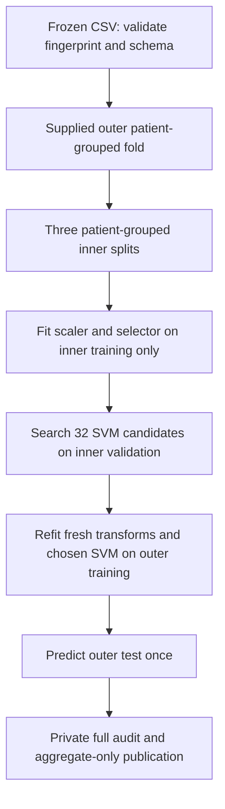

# Breast Ultrasound Classification with Fuzzy-Rough Feature Selection

[](https://github.com/naazzarov/busbra-ultrasound-classification/actions/workflows/tests.yml)


A controlled comparison of **all-feature SVM**, **conventional fuzzy-rough selection + SVM**,
and **a documented GBFRS reconstruction + SVM** on BUS-BRA radiomics. The question is
whether the classifier can use far fewer measurements while retaining similar
observed performance under patient-grouped nested evaluation.

**Status:** all three complete real-data runs reproduced on 28 October 2026.
The paper is a research draft for author review, not an accepted publication.
The dataset, identifiers, row-level predictions and model artifacts remain private.

## Results at a glance

The unchanged input contains **1,875 images**, **1,064 patient groups** and
**288 named predictors**. Every method uses the same five supplied outer folds,
three grouped inner folds and 32 SVM candidates.

| Method | Outer-fold macro-F1, mean ± SD | Mean features | Feature reduction |
|---|---:|---:|---:|
| All-feature SVM | 0.8534 ± 0.0436 | 288 | 0.00% |
| Fuzzy-rough + SVM | 0.8501 ± 0.0362 | 7.6 | 97.36% |
| GBFRS reconstruction + SVM | 0.8540 ± 0.0417 | 13 | 95.49% |


The point differences are small. All paired conditional patient-bootstrap intervals
for differences in pooled macro-F1 span zero. This does **not** establish equivalence,
non-inferiority or clinical utility. The main observation is a substantial reduction
in classifier inputs with close observed scores on this dataset.

[Aggregate results](results/aggregate_results.json) · [Statistical interpretation](docs/STATISTICAL_ANALYSIS.md) · [Paper source](paper/main.tex)

## Reproduce the evaluation

Use Python 3.12 and the frozen private team CSV. The CLI verifies its byte fingerprint
before training. The raw image dataset alone does not reproduce the prepared table
without the upstream extraction environment.

```bash
git clone https://github.com/naazzarov/busbra-ultrasound-classification.git
cd busbra-ultrasound-classification
uv sync --locked
uv run --locked pytest
uv run --locked busbra validate --data /PRIVATE/PATH/BUSBRA_features_ready.csv
uv run --locked busbra run-all \
  --data /PRIVATE/PATH/BUSBRA_features_ready.csv \
  --output private_outputs/new-run --jobs 2
uv run --locked busbra summarize \
  --data /PRIVATE/PATH/BUSBRA_features_ready.csv \
  --submissions private_outputs/new-run/submissions \
  --output private_outputs/new-run/aggregate_results.json --bootstrap 5000
```

`run-all` executes methods sequentially and records completion or failure in a private
manifest. It refuses to overwrite an existing run. Each method also has its own CLI
command: `baseline`, `fuzzy_rough` or `gbfrs` with the same data/output/jobs arguments.
There are no fabricated sample outputs or automatic downloads of research data.

## How information stays inside training partitions



Feature selection is refitted on every inner training set and outer refit. No
clinical metadata, engineered predictors, PCA, global filtering, resampling or
test-tuned decision threshold is introduced. All 288 named predictors remain
available, including the 42 reported exact-value redundancies.

## GBFRS implementation qualification

The GBFRS pipeline is an **independent reconstruction of the accessible 2025
preprint**, with documented normalization, initialization, overlap handling and
stopping choices. It uses the paper's own-ball-weighted dependency in Equation 13.
The inspected author archive has no code license and computes a different dependency
expression; it is neither imported nor redistributed. These results are not a
numerical replication of the author program or its published benchmark tables.

[Method equations](docs/METHODS.md) · [Reference audit](docs/REFERENCE_AUDIT.md) · [Evaluation contract](evaluation/evaluation_contract.json)

## Paper and analysis

The draft is **Patient-Grouped Evaluation of Fuzzy-Rough Feature Selection for Breast
Ultrasound Classification**, by Bahodir Nazarov, Zineb Gharib and Fatima Zazoul;
Luo Chuan is acknowledged. Author details and research statements require author
review before submission.

- [Manuscript and build instructions](paper/README.md)
- [Results and uncertainty](docs/RESULTS.md)
- [Dataset provenance and restrictions](docs/DATASET.md)
- [Exact private submission format](docs/SUBMISSION_FORMAT.md)
- [Development and completion record](docs/PORTFOLIO_PROGRESS.md)

The public JSON contains aggregate metrics only. The conditional bootstrap holds
OOF predictions fixed and does not estimate all retraining uncertainty. Stability
is descriptive across five overlapping training sets. There is no external cohort,
clinical validation or new feature-selection algorithm claimed here.

## Source, attribution and reuse

This personal extension retains the original team's Git history and credits.
Historical team assignments remain documented in [TEAM_ROLES.md](docs/TEAM_ROLES.md).
Use [CITATION.cff](CITATION.cff) to cite the software and cite the original research:

- Gómez-Flores, Gregorio-Calas and Pereira, [BUS-BRA](https://doi.org/10.1002/mp.16812), *Medical Physics* (2024).
- Jensen and Shen, [fuzzy-rough feature selection](https://doi.org/10.1109/TFUZZ.2008.924209), *IEEE TFS* (2009).
- Xia et al., [GBFRS preprint](https://arxiv.org/abs/2501.18413) (2025).

Original images are distributed by their creators through [Zenodo](https://zenodo.org/records/8231412).
Dataset availability does not authorize redistribution of this private handoff.
No blanket software or manuscript reuse license is asserted on behalf of other
contributors. This is computational research, not a medical diagnostic service.
